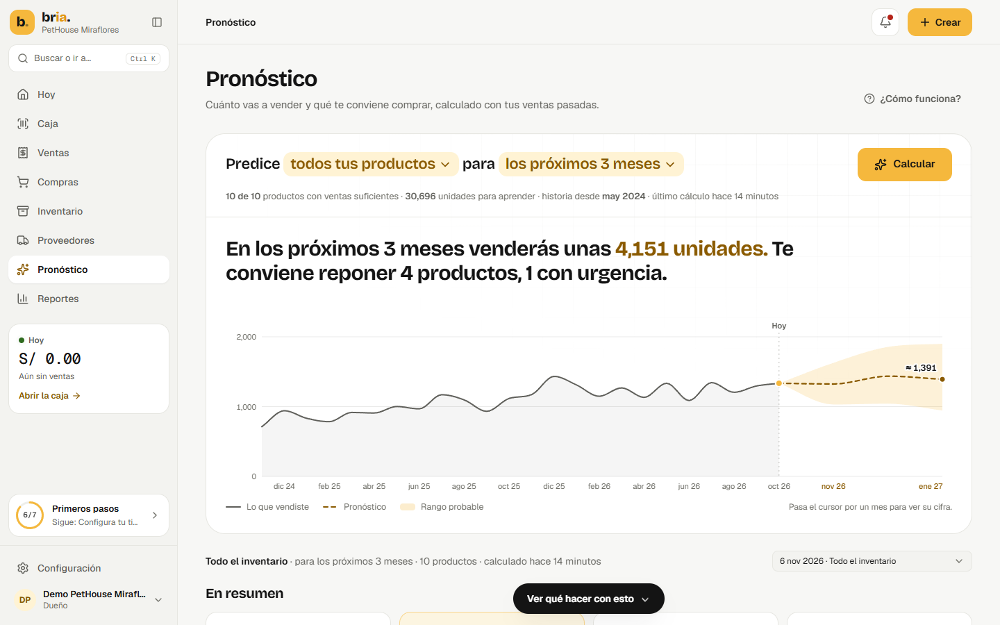
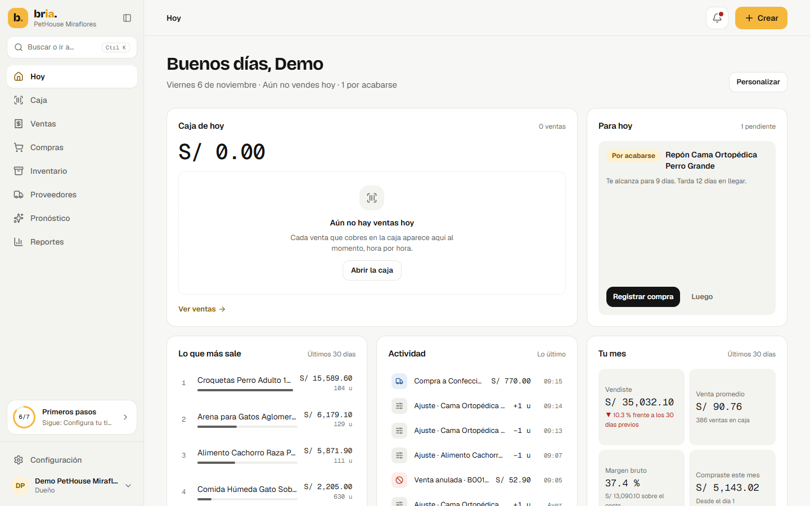
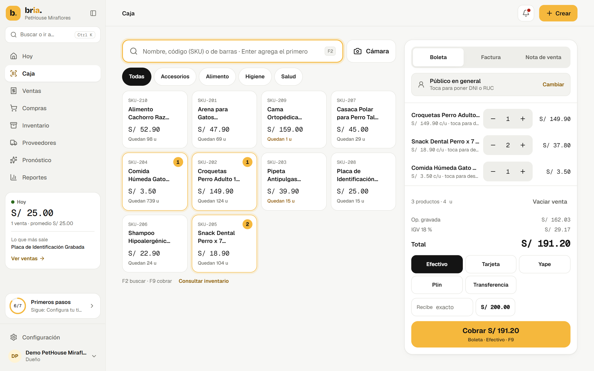

# bria. · aplicación web

Interfaz de **bria.**, el sistema de apoyo a decisiones de inventario para pequeños negocios retail del Perú. Una dueña cobra en caja, controla su stock y sus compras, y ve cuánto venderá cada producto y qué conviene comprar, con el motivo a la vista y la decisión en sus manos.



*Capturas con datos sintéticos de una tienda de prueba.*

| Inicio | Caja |
|---|---|
|  |  |

## Qué hay en la aplicación

| Área | Rutas | Qué permite |
|---|---|---|
| Entrada | `/login`, `/welcome` | Dueño con correo, vendedor con usuario, y primeros pasos guiados |
| Hoy | `/dashboard` | Caja del día, pendientes, ventas del mes y más vendidos |
| Ventas y caja | `/sales`, `/sales/new`, `/sales/[orderId]`, `/sales/stock` | Cobro con boleta, factura o nota de venta, historial, anulación e inventario para el vendedor |
| Inventario | `/inventory`, `/inventory/[productId]`, `/inventory/import` | Productos, ficha completa, ajustes e importación desde Excel con columnas propias |
| Compras | `/purchases`, `/purchases/new`, `/suppliers`, `/suppliers/[supplierId]` | Compras y proveedores |
| Pronóstico | `/forecasting`, `/forecasting/[runId]` | Cuánto se venderá, qué comprar, por qué y con qué precisión |
| Reportes y avisos | `/reports`, `/notifications` | Reportes descargables y alertas |
| Configuración | `/settings`, `/settings/users`, `/premium` | Negocio, equipo y permisos, apariencia y plan |

## Stack

Next.js 16 con App Router y Turbopack · React 19 · TypeScript estricto · Tailwind CSS 4 · Recharts · Lucide · date-fns.

La web solo consume endpoints reales de [`bria-api`](https://github.com/bria-app/bria-api): no hay datos simulados en pantalla.

## Arranque

Para levantar el sistema completo con datos de prueba, usa [`bria-local`](https://github.com/bria-app/bria-local). Para trabajar solo en la web, con Node.js 20 y la API en marcha:

```bash
npm ci
```

```bash
npm run dev
```

Abre http://localhost:3000.

| Variable | Para qué | Por defecto |
|---|---|---|
| `NEXT_PUBLIC_API_BASE_URL` | Dirección de la API. Se fija al compilar | `http://localhost:8000/api/v1` |
| `NEXT_PUBLIC_APP_NAME` | Nombre de la aplicación | Ver `.env.example` |
| `NEXT_PUBLIC_ENVIRONMENT` | Entorno que se muestra en la aplicación | `development` |
| `NEXT_PUBLIC_LANDING_URL` | A dónde lleva el logo en la pantalla de entrada | `/login` |

## Comandos

| Comando | Qué hace |
|---|---|
| `npm run dev` | Servidor de desarrollo |
| `npm run build` | Compilación de producción |
| `npm run start` | Sirve la compilación |
| `npm run typecheck` | Revisa los tipos |
| `npm run lint` | Revisa el estilo y las reglas de capas |

## Estructura

```text
src/
├── app/            Rutas de Next.js: páginas finas
├── features/       Módulos por dominio: auth, dashboard, forecasting, pos, sales, invoicing,
│                   inventory, products, purchases, suppliers, import, custom-fields,
│                   reports, settings, premium, onboarding, first-steps
├── components/
│   ├── layout/     Armazón: barra lateral, barra superior, dock y guardia de rutas
│   ├── ui/         Piezas base sin dominio
│   ├── brand/      Marca
│   └── charts/     Gráficos compartidos
├── hooks/          Estado compartido: useApi, useProfile, useRole, preferencias
├── services/       Acceso al backend: api/client.ts, un archivo por recurso y auth.ts
├── lib/            Funciones puras: formato, fechas de Lima, IGV y apariencia
└── types/          Contratos de la API
```

Cada capa importa solo de las que están debajo en esta lista. La excepción es el armazón, `components/layout`, que compone módulos. ESLint lo verifica.

La guía de diseño, de lenguaje y de código está en [`docs/DESIGN.md`](docs/DESIGN.md).

## Despliegue

Va en Vercel y detecta Next.js solo: define `NEXT_PUBLIC_API_BASE_URL` y despliega. También puede ir en Railway con `railway.json` y `Dockerfile.prod`. La guía completa está en [`bria-local/docs/DESPLIEGUE.md`](https://github.com/bria-app/bria-local/blob/main/docs/DESPLIEGUE.md).

## Seguridad

`next.config.mjs` define las cabeceras de seguridad. La política de contenido limita las conexiones del navegador a este sitio y a la API. La web guarda la sesión en el navegador y cada pantalla respeta el rol del usuario, pero los permisos reales los aplica la API.

## Límites conocidos

- La recuperación de contraseña por correo todavía no está disponible: el dueño o el administrador la restablece.
- El pago de Premium es de demostración: activa el plan, pero no cobra.
- Los comprobantes son internos: no se envían a SUNAT.

Proyecto de tesis de Ingeniería de Software, UPC (TP2026010042). Uso académico: el código no se distribuye con licencia abierta.
